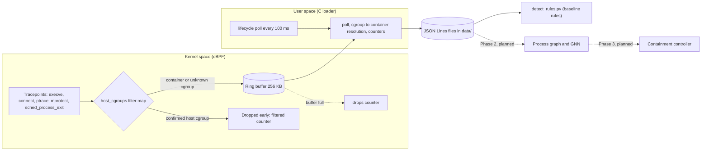

# Architecture

Status: Phase 1 (kernel tracing and dataset) is built and tested. Phases 2 and 3 are planned.

## Data flow

## Components

| Component | File | Role |
|---|---|---|
| eBPF programs | `bpf/ringbuf.bpf.c` | Five tracepoints; build one `struct event`; filter host events before the ring buffer |
| Shared structs | `bpf/common.h` | Event layout used by kernel and user space (tagged union with a type field) |
| Loader | `src/loader.c` | Loads and attaches the programs, reads the ring buffer, maps cgroup ID to container ID and name, counts events, writes JSON Lines |
| Scripts | `scripts/` | Build, tests, benchmark, dataset recording, attack demo, audit |

## Event model

Every event carries: kernel timestamp (CLOCK_MONOTONIC), cgroup ID, PID, PPID, UID, process name, type, and a payload that depends on the type.

| Type | Payload |
|---|---|
| exec | filename |
| connect | IPv4 or IPv6 address, port |
| ptrace | request, target PID |
| mprotect | address, length, protection (only calls with PROT_EXEC) |
| exit | exit status, signal (thread group leader only) |
| container_start / container_stop | container ID, name, cgroup ID, preexisting flag (from the loader, not the kernel) |

## Container identification

The kernel only knows the cgroup ID, which equals the inode of the cgroup v2 directory. The loader scans `/sys/fs/cgroup/system.slice` and `/sys/fs/cgroup/docker` for 64-character container directories, caches the inode, and reads the name from Docker's `config.v2.json`. A miss triggers a rescan at most every 20 ms.

## Design decisions

- **One ring buffer for all event types** keeps global event order.
- **Fail-open host filter.** The kernel drops only cgroups the loader has confirmed as host. Unknown cgroups still reach user space, so a new container's first events are never hidden. A fail-closed design recreated this blind spot during development.
- **Drops are counted, not hidden.** A per-CPU array counts every failed reservation and the loader prints it at exit.
- **Filtering `mprotect` in the kernel** (only PROT_EXEC) removes most of its volume.

## Trust boundaries

The loader runs as root and trusts the kernel. Container processes are untrusted, so all their input (filenames, addresses) is copied with `bpf_probe_read_user*` and JSON-escaped. The tracer does not block or modify any syscall: it observes only.

## Measured results

See `docs/bench-results.txt` for overhead and `docs/VERIFICATION.md` for what was tested and when. The measurements were taken on WSL2, so absolute numbers will differ on bare metal.

## Known limitations

- Only Docker cgroup layouts under `system.slice` and `docker` are recognised.
- Container start and stop are detected by polling, with up to about 100 ms delay.
- A container removed within milliseconds of its first event can lose its name.
- IPv4 and IPv6 `connect` are traced, but `sendto` on unconnected UDP sockets is not.
- The baseline dataset is small (a few hundred events), so the rule-based demo is brittle.
- Detection latency measured so far covers kernel to user space only, not model or containment time.

## Planned (not built)

- Process graph construction and R-GCN or TGN anomaly model (Phase 2)
- Containment through the Docker API and cgroups, plus a telemetry dashboard (Phase 3)
